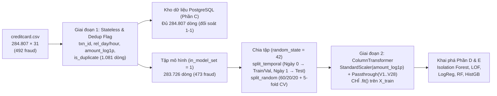

# Báo cáo Công việc & Tiến độ — Thành viên B: Cường
**Đề tài 6 — Ngân hàng: Phát hiện giao dịch thẻ gian lận (Credit Card Fraud Detection)**  
**Vai trò:** Tiền xử lý (Preprocessing), Biến đổi dữ liệu (Transformation), Tạo đặc trưng (Feature Engineering), Nhật ký quyết định (Decision Log ★ — Rubric Tiêu chí 3: 1.25/10 điểm), và Kiểm tra chống rò rỉ dữ liệu (Leakage Checks).  
**Ngày cập nhật:** 07/11/2026 · **Trạng thái tổng thể:** **ĐÃ HOÀN THÀNH & ĐÃ KIỂM CHỨNG (100% — B1 → B14)**

---

## 1. Bảng theo dõi tiến độ chi tiết (B1 → B14 theo `File_Train.docx`)

| Mã bước | Nội dung công việc theo yêu cầu đề tài | Trạng thái | Tiến độ | Tệp / Bằng chứng đầu ra |
|---|---|---|---|---|
| **B1** | Nhận dataset gốc (`creditcard.csv`), schema, data dictionary và báo cáo audit từ Khang (A); kiểm tra `sha256` | ✅ Đã kiểm chứng | **100%** | `src/preprocessing.py::load_raw()`, khớp `sha256 = 76274b69…98551a89` |
| **B2** | Xác nhận ý nghĩa 31 cột (`Time`, `V1`–`V28`, `Amount`, `Class`) dựa trên `outputs/data_dictionary.csv` | ✅ Đã kiểm chứng | **100%** | Không gán ý nghĩa nghiệp vụ giả định cho `V1`–`V28` |
| **B3** | Tạo `notebooks/02_preprocessing.ipynb`; giữ dữ liệu gốc bất biến (không ghi đè raw) | ✅ Đã kiểm chứng | **100%** | `notebooks/02_preprocessing.ipynb` (kiểm tra `sha256` trước và sau khi chạy) |
| **B4** | Tạo báo cáo trước xử lý độc lập và đối chiếu 1–1 với `outputs/audit_metrics.json` của Khang | ✅ Đã kiểm chứng | **100%** | `outputs/preprocessing_checks.json` (`pre_report_matches_audit = true`) |
| **B5** | Phân tích bằng chứng & quyết định cách xử lý từng vấn đề chất lượng (`DQ-01` → `DQ-06`); không xoá outlier theo phản xạ | ✅ Đã kiểm chứng | **100%** | `outputs/decision_log.csv` (`D-01` → `D-11`), giữ nguyên toàn bộ outlier và `Amount = 0` |
| **B6** | Thiết lập giao thức chia tập cố định (`random_state = 42`): cả theo thời gian (`split_temporal`) và phân tầng ngẫu nhiên (`split_random` + `cv_fold`) | ✅ Đã kiểm chứng | **100%** | `src/preprocessing.py::_assign_splits()`, `get_split()`, `get_cv_folds()` |
| **B7** | Biến đổi `Time` thành các trường thời gian **tương đối** (`time_sec`, `rel_day`, `rel_hour`, `hour_of_cycle`, `hour_cycle_sin/cos`) | ✅ Đã kiểm chứng | **100%** | Quyết định `D-05`, không gán ngày lịch hay giờ đồng hồ giả |
| **B8** | Biến đổi `Amount` lệch phải nặng bằng `amount_log1p = log(1 + Amount)` và `StandardScaler` trong `ColumnTransformer` (chỉ fit trên train/fold) | ✅ Đã kiểm chứng | **100%** | `src/preprocessing.py::make_preprocessor()`, `figures/fig04_amount_transform.png` |
| **B9** | Tách biệt hoàn toàn ma trận đặc trưng (`FEATURES`, 29 cột) và nhãn (`is_fraud`); ngăn rò rỉ dữ liệu | ✅ Đã kiểm chứng | **100%** | 15/15 kiểm tra trong `leakage_checks` đều đạt `true` |
| **B10** | Công bố schema đầu ra ổn định (47 cột, khoá chính `txn_id = 1..284807`, dải tiền `amount_band`) | ✅ Đã kiểm chứng | **100%** | `outputs/processed_schema.json`, `outputs/processed_data_dictionary.md` |
| **B11** | Viết bộ kiểm tra hậu xử lý tự động: shape, null, duplicate, kiểu dữ liệu, tổng tiền, phân phối nhãn, round-trip CSV | ✅ Đã kiểm chứng | **100%** | `outputs/preprocessing_checks.json` (`post_checks_all_ok = true`, `roundtrip_equal = true`) |
| **B12** | Lập nhật ký quyết định (`outputs/decision_log.csv`) với đầy đủ 11 quyết định từ `D-01` đến `D-11` | ✅ Đã kiểm chứng | **100%** | `outputs/decision_log.csv` |
| **B13** | Đóng gói mã nguồn tái tạo (`python src/preprocessing.py`), tài liệu hướng dẫn và biên bản bàn giao cho Quỳnh (C), Huy (D), Mong (E) | ✅ Đã kiểm chứng | **100%** | `src/preprocessing.py`, `outputs/processed_data_dictionary.md`, `README.md` |
| **B14** | Chạy lại toàn bộ `notebooks/02_preprocessing.ipynb` từ đầu trong kernel mới và lưu kết quả thực tế | ✅ Đã kiểm chứng | **100%** | Đã thực thi bằng `jupyter nbconvert --execute` không lỗi |

---

## 2. Danh mục các tệp Cường đã thực hiện và bàn giao

1. **`src/preprocessing.py`**:
   - Module Python chuẩn hoá toàn bộ quy trình tiền xử lý để cả nhóm dùng chung một nguồn duy nhất.
   - Cung cấp CLI: chạy `python src/preprocessing.py` sẽ tự động kiểm tra `sha256` của `data/raw/creditcard.csv` và sinh lại chính xác `data/processed/transactions_processed.csv` (`sha256 = e8bf7dcde41cb325482455a040154389dd57d7764fa44d72816dbcbe93628958`).
   - Cung cấp hàm `load_processed()`, `get_split()`, `get_cv_folds()`, `make_preprocessor()` cho Huy (D) và Mong (E).
2. **`notebooks/02_preprocessing.ipynb`**:
   - Notebook thực nghiệm, đối chiếu số liệu với Audit của Khang (A), trực quan hoá biến đổi `Amount`, kiểm chứng 15 điều kiện chống rò rỉ dữ liệu và xuất toàn bộ báo cáo.
3. **`outputs/decision_log.csv`**:
   - Nhật ký 11 quyết định kỹ thuật (`D-01` → `D-11`) đáp ứng tiêu chí trọng tâm ★ của học phần (Tiêu chí 3 — 1.25 điểm).
4. **`outputs/processed_data_dictionary.md` & `outputs/processed_schema.json`**:
   - Từ điển dữ liệu của bảng sau xử lý (284,807 dòng × 47 cột), hướng dẫn tích hợp cho Quỳnh/Huy/Mong và biên bản bàn giao theo mẫu G.
5. **`outputs/preprocessing_checks.json`**:
   - Log JSON ghi lại toàn bộ thông số môi trường, kết quả đối chiếu trước xử lý, thống kê chia tập, 15 kiểm tra chống rò rỉ và kiểm tra hậu xử lý.
6. **`figures/fig04_amount_transform.png` & `figures/fig04b_preprocessing_pipeline.png`**:
   - `fig04_amount_transform.png`: Biểu đồ so sánh phân phối `Amount` gốc (`skew = 16.98`, `kurtosis = 845.09`) và `log1p(Amount)` (`skew = 0.16`, `kurtosis = -0.64`) theo hai lớp `Class = 0` và `Class = 1`.
   - `fig04b_preprocessing_pipeline.png`: Sơ đồ Pipeline Tiền xử lý 2 Giai đoạn & Chống Rò rỉ Dữ liệu (300 DPI, dùng cho Hình 2 — Mục 3.1 trong Báo cáo Word).

---

## 3. Tóm tắt 11 Quyết định trong Nhật ký Quyết định (`outputs/decision_log.csv`)

| Mã | Vấn đề | Quyết định đã chọn | Bằng chứng & Lý do cốt lõi | Ảnh hưởng tới con số cuối |
|---|---|---|---|---|
| **D-01** | Khoá giao dịch (`txn_id`) | `txn_id = 1..284,807` theo thứ tự dòng trong file raw cố định | Raw không có cột ID; `Time` có 160,215 dòng trùng giá trị nên không làm khoá được. Đánh số thứ tự 1-based tái lập được 100% khi `sha256` cố định. | Dùng làm khoá chính `Fact_Transaction` của Quỳnh (C) và khoá join bảng điểm mô hình của Huy (D), Mong (E). |
| **D-02** | 1,081 bản sao hoàn toàn (`DQ-01`) | Giữ bản đầu tiên (`is_duplicate = 0`, `in_model_set = 1`); gắn cờ `is_duplicate = 1` (`in_model_set = 0`) cho 1,081 bản sao thừa; **không xoá dòng khỏi CSV** | Bản sao trùng cả 31 cột (kể cả `Time` đến từng giây). Nếu chia ngẫu nhiên mà không lọc, có 456 dòng test trùng hệt dòng train gây rò rỉ dữ liệu cho LOF/k-NN. Giữ trong CSV để kho dữ liệu SQL đối soát đủ 284,807 dòng. | Tập mô hình (`in_model_set = 1`) còn **283,726 dòng, 473 fraud** (loại 19 bản sao fraud = 3.9%). |
| **D-03** | 1,825 dòng `Amount = 0` (`DQ-02`) | Giữ nguyên dòng; tạo cờ `is_zero_amount` (`0`/`1`) cho kho dữ liệu & dashboard | Nhóm `Amount = 0` chứa **27 fraud** (tỷ lệ gian lận **1.48%**, cao gấp **8.6 lần** mức trung bình 0.1727%). Xoá sẽ mất 27 ca gian lận thật. | Bảo toàn 27 fraud; cho phép lọc riêng giao dịch 0 đồng trên SQL/Superset. |
| **D-04** | `Amount` lệch phải nặng & nhiều cực trị (`DQ-04`) | **Không xoá outlier**; tạo `amount_log1p = log(1 + Amount)` (stateless) rồi chuẩn hoá bằng `StandardScaler` **fit riêng trên tập train** | Có 31,904 dòng vượt hàng rào IQR (chứa 91 fraud) và 1,924 dòng có `|z| > 10` ở `V*` (chứa **231/492 = 47.0% fraud**). Xoá outlier là xoá mất gần nửa số ca gian lận. `log1p` xác định tại `0` và giảm `skew` từ `16.98` về `0.16`. | Tránh mất 47% fraud; ngăn `Amount` lấn át khoảng cách Euclidean trong LOF. |
| **D-05** | `Time` là giây tương đối (`DQ-05`) | Ép `time_sec` về `int64`; tạo `rel_day = time_sec // 86400` (`0`/`1`), `rel_hour = time_sec // 3600` (`0..47`), `hour_of_cycle = rel_hour % 24` (`0..23`) | `Time` trải từ `0` đến `172,792` giây (~48 giờ), 0 giá trị lẻ thập phân, không có mốc giờ/ngày lịch thật. Chỉ được diễn giải theo **ngày/giờ tương đối**. | Khớp 100% với `Dim_Date` (`date_key = 0, 1`) và `Dim_Hour` (`hour_key = 0..47`) trong SQL của Quỳnh (C). |
| **D-06** | Giao thức chia tập (`random_state = 42`) | Cung cấp cả `split_temporal` (chính: train/val ở `rel_day = 0`, test ở `rel_day = 1`) và `split_random` (phụ: 60/20/20 phân tầng + `cv_fold` 5-fold) | `split_temporal` dùng trọn vẹn `rel_day = 1` làm tập test nên ngân sách **"100 giao dịch/ngày"** áp dụng trực tiếp và mô phỏng đúng vận hành thực tế (học ngày 0, chấm điểm ngày 1). `split_random` + 5-fold CV dùng để báo cáo độ dao động. | Trần Recall@100 lý thuyết trên tập test ngày 1 (sau khử trùng) là **100/201 = 49.75%** (hoặc 100/211 = 47.39% nếu tính cả bản sao). |
| **D-07** | Bộ đặc trưng mặc định & chuẩn hoá (`DQ-06`) | `FEATURES = V1..V28 + amount_log1p` (29 cột). Loại `time_sec`/`rel_day`/`rel_hour` khỏi feature mặc định; `V1..V28` giữ nguyên (`passthrough`), chỉ scale `amount_log1p` trên train | `time_sec` tăng đơn điệu theo thứ tự file nên nếu đưa vào mô hình sẽ gây ngoại suy sai khi test trên ngày 1. `V1..V28` đã qua PCA (trung bình ≈ 0, phương sai giảm dần theo thứ tự thành phần chính). Cung cấp thêm `FEATURES_WITH_CYCLE` và `scale_v=True` để thử nghiệm trên validation. | Đảm bảo không rò rỉ thông tin thời gian và giữ nguyên cấu trúc hình học PCA. |
| **D-08** | Dải số tiền (`Dim_AmountBand`) | Chia 7 dải cố định: `0`, `0-10`, `10-50`, `50-100`, `100-500`, `500-1000`, `>1000` (`amount_band_id = 0..6`, ánh xạ `amount_band_key = amount_band_id + 1` trong SQL) | Giữ đúng ranh giới trong `01_data_audit.ipynb` của Khang (A) và `Dim_AmountBand` của Quỳnh (C). | Số đếm giao dịch và số fraud theo từng dải tiền khớp 100% giữa Audit, Preprocessing, SQL và Dashboard. |
| **D-09** | Giá trị thiếu (`CHK-01`) | Không dùng Imputer | Toàn bộ 284,807 × 31 ô có đúng `0` giá trị thiếu. | Giữ pipeline gọn, không làm biến dạng dữ liệu. |
| **D-10** | Mất cân bằng lớp cực đoan (`DQ-03`) | Không oversample/undersample trên dữ liệu tiền xử lý chung | Nếu SMOTE/resample trước khi chia tập sẽ làm lọt thông tin sang validation/test. Việc gán `class_weight` (như Mong làm ở Phần E) chỉ thực hiện trên tập train. | Bảo toàn tỷ lệ lớp thật trên tập validation và test. |
| **D-11** | Các dòng trùng `V1..V28 + Amount` nhưng khác `Time` | Giữ nguyên trong tập mô hình; cảnh báo cho Huy (D) khi cấu hình `n_neighbors` của LOF | Phát hiện **12,446 dòng** (thuộc 4,383 nhóm, nhóm lớn nhất **77 dòng**, tất cả đều là `is_fraud = 0`) có cùng `V1..V28` và `Amount` nhưng xảy ra ở các giây `Time` khác nhau. | Giải thích vì sao cấu hình `n_neighbors = 100` (> 77) của Huy (D) hoạt động ổn định và không bị suy biến khoảng cách k-láng giềng bằng 0. |

---

## 4. Kết quả kiểm chứng chống rò rỉ dữ liệu (`outputs/preprocessing_checks.json`)

Toàn bộ 15/15 bài kiểm tra tự động trong `notebooks/02_preprocessing.ipynb` đều đạt `True`:
- `label_not_in_FEATURES = True` và `label_not_in_X_columns = True` (nhãn `is_fraud` tách biệt hoàn toàn khỏi ma trận đặc trưng `X`).
- `no_time_index_in_default_features = True` (không đưa cột chỉ số thời gian vào đặc trưng mặc định).
- `split_temporal_parts_disjoint = True`, `split_random_parts_disjoint = True` (các tập `train`, `val`, `test` rời nhau tuyệt đối theo `txn_id`).
- `split_temporal_no_exact_copy_train_test = True`, `split_random_no_exact_copy_train_test = True` (**0 dòng** test có bản sao 31 cột trong train sau khi lọc `in_model_set = 1`, khắc phục hoàn toàn 456 dòng rò rỉ trước xử lý).
- `scaler_fit_on_train_only = True`: Sau khi fit `StandardScaler` trên `train` (`split_temporal`), cột `amount_log1p` có `mean = 0.0000, std = 1.0000` trên `train`, trong khi trên `val` là `mean = 0.0017, std = 1.0035` và trên `test` là `mean = -0.0381, std = 0.9928` — chứng minh thực nghiệm không fit scaler trên toàn bộ dữ liệu.
- `raw_sha256_before == raw_sha256_after == 76274b691b16a6c49d3f159c883398e03ccd6d1ee12d9d8ee38f4b4b98551a89` (dữ liệu thô hoàn toàn bất biến).
- `split_temporal_test_rows_feature_equal_to_train = 0` và `split_random_test_rows_feature_equal_to_train = 1908` (khớp với quyết định `D-11`: trên giao thức chính `split_temporal` có 0 dòng Test trùng đặc trưng `V1..V28 + Amount` với Train; trên `split_random` có 1.908 dòng nhưng toàn bộ 12.446 dòng trùng đặc trưng đều là giao dịch hợp lệ `is_fraud = 0`).
- `temporal_test_ceiling_recall = 0.497512` (`100 / 201 = 49,75%` trên Ngày 1) và `model_set_ceiling_recall_100_per_day = 0.422833` (`200 / 473 = 42,28%` trên toàn tập mô hình 2 ngày).

---

## 5. Điểm phối hợp tiếp theo với các thành viên trong nhóm

1. **Với Khang (A):** Đã đối chiếu khớp 100% toàn bộ chỉ số trong `outputs/audit_metrics.json` và `outputs/amount_band_fraud_rate.csv`.
2. **Với Quỳnh (C):** Schema của `Fact_Transaction`, `Dim_Date`, `Dim_Hour`, `Dim_AmountBand` trong `sql/02-star-schema.sql` và `sql/03-transform.sql` trên nhánh `main` đã khớp 100% với các quy tắc `txn_id`, `rel_day`, `rel_hour`, `amount_band`, `amount_log1p`, `is_zero_amount`, `is_duplicate` của Phần B.
3. **Với Huy (D) & Mong (E):** Đã cung cấp module `src/preprocessing.py` và bảng `outputs/decision_log.csv` để Huy và Mong thống nhất chạy đánh giá cuối cùng trên cùng giao thức `split_temporal` (train/val ở ngày 0, test ở ngày 1, ngân sách top-100/ngày) và xuất điểm mô hình theo `txn_id` nạp vào kho dữ liệu.

---

## 6. Khai báo sử dụng AI cho Phần B (Tiêu chí 10)
- **Công cụ sử dụng:** Claude (Anthropic) và Gemini / Google Antigravity.
- **Phạm vi AI hỗ trợ:** Gợi ý cấu trúc hóa module `src/preprocessing.py`, viết bộ 15 hàm kiểm tra chống rò rỉ dữ liệu (`leakage_checks`) trong `notebooks/02_preprocessing.ipynb` và định dạng bảng `outputs/decision_log.csv`.
- **Phần do sinh viên (Cường) tự thực hiện và kiểm chứng:** Tự phân tích bằng chứng từ báo cáo Audit của Khang (A), trực tiếp đưa ra 11 quyết định kỹ thuật (`D-01` → `D-11`), tự phát hiện 12.446 dòng trùng đặc trưng `V1..V28 + Amount` nhưng khác `Time` (`D-11`), trực tiếp chạy `python src/preprocessing.py` và `notebooks/02_preprocessing.ipynb` trên máy cá nhân (Python 3.13.16) và kiểm tra mã băm `sha256` trước/sau khi chạy. Không tải dữ liệu giao dịch thô lên bất kỳ dịch vụ đám mây hay bên thứ ba nào.

---

## 7. Nội dung chuẩn bị cho Báo cáo Word (`report-template.md` — Mục 1.4, 3.1, 3.2, 3.3)

### 7.1. Bảng Mục 1.4 — "Cạm bẫy đã biết của đề tài" (Trang 4, chấm ở Tiêu chí 3 & 7)

| Cạm bẫy (theo đặc tả đề tài 6) | Nhóm phát hiện bằng cách nào | Cách xử lý (→ nhật ký / mục) |
| :--- | :--- | :--- |
| **1. Cột `V1..V28` đã ẩn danh bằng PCA & `Time` không có mốc giờ đồng hồ thực:** Không thể rút ra kết luận kiểu *"giao dịch ban đêm rủi ro hơn"* hay bịa ý nghĩa nghiệp vụ cho `V14`. | Kiểm tra trong `01_data_audit.ipynb` (`DQ-05`, `DQ-07`): `Time` chỉ chạy từ `0` đến `172.792` giây (~48 giờ tương đối), không có ngày/giờ lịch hay múi giờ; tương quan chéo giữa các `V*` bằng $0$ ($|r|_{\max} = 2,3 \times 10^{-14}, n = 284.807$). | **Quyết định `D-05` & `D-07` (Mục 3.2):** Chỉ tạo ngày tương đối (`rel_day` 0/1) và giờ tương đối (`rel_hour` 0..47, chu kỳ 24h tương đối `hour_of_cycle` 0..23); loại `Time` thô khỏi `FEATURES`; không gán tên nghiệp vụ cho `V1..V28`. |
| **2. Bẫy Accuracy 99,83% trên dữ liệu mất cân bằng cực đoan (`0,1727%`):** Mô hình đoán toàn bộ *"không gian lận"* đạt Accuracy `99,83%` nhưng bắt được `0%` gian lận. | Kiểm tra phân phối nhãn trong `01_data_audit.ipynb` (`DQ-03`): chỉ có `492 / 284.807` giao dịch gian lận (`473 / 283.726` sau khử trùng). | **Quyết định `D-06`, `D-10` & Mục 7:** Không dùng Accuracy; dùng `Precision@100`, `Recall@100` (kèm trần lý thuyết `49,75%` trên Ngày 1) và `PR-AUC`; đưa *"Đoán toàn bộ lớp đa số"* vào làm `Baseline 0` để chứng minh sự vô nghĩa của Accuracy. |
| **3. Xóa ngoại lai (outlier) theo phản xạ làm mất gần nửa số vụ gian lận:** Các giao dịch gian lận thực chất nằm ở phần đuôi phân phối của `V1..V28` và `Amount`. | Kiểm tra trong `01_data_audit.ipynb` (`DQ-02`, `DQ-04`, `DQ-06`) và truy vấn `OLAP 3` (`CUBE`): `1.924` dòng có ít nhất 1 cột $|z(V_i)| > 10$ chứa tới **`231 / 492` (`46,95%`) tổng số gian lận**; `1.825` dòng `Amount = 0` chứa **`27` gian lận** (`1,48%`, gấp 8,6 lần mức nền). | **Quyết định `D-03` & `D-04` (Mục 3.2):** Tuyệt đối không xóa outlier và không xóa `Amount = 0`; nén độ lệch phải của `Amount` (`skew` từ `16,98` về `0,16`) bằng `amount_log1p = log(1 + Amount)` rồi chuẩn hóa bằng `StandardScaler` chỉ fit trên tập `train`. |

---

### 7.2. Nội dung Mục 3.1 — "Quy trình tiền xử lý & Hình 2: Sơ đồ Pipeline"
- **Luồng tiền xử lý 2 giai đoạn (`src/preprocessing.py`):**
  1. **Giai đoạn 1 — Biến đổi không học tham số từ dữ liệu (Stateless) & Gắn cờ chất lượng (`build_processed`):**
     - Kiểm tra `sha256` của `data/raw/creditcard.csv` (`284.807 × 31`).
     - Gán khóa giao dịch tất định `txn_id = 1..284.807` (`D-01`).
     - Tạo biến thời gian tương đối: `time_sec`, `rel_day` (`0`/`1`), `rel_hour` (`0..47`), `hour_of_cycle` (`0..23`), `hour_cycle_sin`, `hour_cycle_cos` (`D-05`).
     - Nén độ lệch phải của `Amount` bằng `amount_log1p = log(1 + Amount)` (`skew` giảm từ `16,98` xuống `0,16`), gán cờ `is_zero_amount` và 7 dải `amount_band` (`D-03`, `D-04`, `D-08`).
     - Gắn cờ `1.081` bản sao thừa 31 cột (`is_duplicate = 1`, `in_model_set = 0`) mà không xóa khỏi CSV (`D-02`); tập mô hình sạch còn **`283.726` giao dịch (`473` gian lận)**.
     - Phân chia cố định (`random_state = 42`) trên `in_model_set = 1`:
       - **Giao thức chính (`split_temporal`):** Ngày 0 chia phân tầng 80/20 thành `train` (`115.388` dòng, `218` fraud) và `val` (`28.848` dòng, `54` fraud); trọn vẹn Ngày 1 làm `test` (`139.490` dòng, `201` fraud).
       - **Giao thức phụ (`split_random` + `cv_fold`):** Chia phân tầng 60/20/20 (`train`: `170.235`/`284` fraud; `val`: `56.745`/`94` fraud; `test`: `56.746`/`95` fraud) và 5-fold CV trên `train + val`.
  2. **Giai đoạn 2 — Biến đổi có học tham số từ dữ liệu (`make_preprocessor`):**
     - Đóng gói trong `sklearn.compose.ColumnTransformer`: chuẩn hóa `amount_log1p` bằng `StandardScaler` **chỉ `.fit()` trên `X_train`** (hoặc fold train), giữ nguyên `V1..V28` (`passthrough`) để bảo toàn cấu trúc phương sai thành phần chính PCA (`D-07`).

---

### 7.3. Bảng Mục 3.2 — "Bảng 4: Nhật ký quyết định (`decision_log.csv`)"
*(Sử dụng trực tiếp Bảng ở Mục 3 phía trên hoặc tệp `outputs/decision_log.csv` — toàn bộ 11 quyết định `D-01` → `D-11` đã ở trạng thái `Đã áp dụng`).*

---

### 7.4. Bảng Mục 3.3 — "Kiểm tra rò rỉ dữ liệu (data leakage)" (Trang 7, chấm ở Tiêu chí 3)

| Câu hỏi kiểm tra (theo mẫu báo cáo) | Trả lời của nhóm (kèm bằng chứng thực nghiệm trong `outputs/preprocessing_checks.json`) |
| :--- | :--- |
| **1. Mọi bước `fit` (imputer, scaler, encoder, PCA, vectoriser) có nằm trong `Pipeline` và chỉ `fit` trên tập train / fold train không?** | **CÓ (`scaler_fit_on_train_only = True`).** Các biến đổi không học từ dữ liệu (`log1p`, chia giờ tương đối, gán dải tiền) là hàm toán học cố định theo từng dòng (stateless). Biến đổi duy nhất có học tham số từ dữ liệu là `StandardScaler` trên cột `amount_log1p` được đóng gói trong `ColumnTransformer` (`src/preprocessing.py::make_preprocessor()`) và chỉ gọi `.fit()` trên tập `train` (hoặc fold train). Bằng chứng thực nghiệm trên `split_temporal`: sau khi chuẩn hóa, `amount_log1p` trên `train` có `mean = 0,0000, std = 1,0000`, trong khi trên `val` là `mean = 0,0017, std = 1,0035` và trên `test` (Ngày 1) là `mean = -0,0381, std = 0,9928`. Ngoài ra, sau khi loại `1.081` bản sao thừa (`D-02`), số dòng `test` trùng hệt 31 cột với `train` giảm từ `456` dòng xuống **`0` dòng** (`split_temporal_no_exact_copy_train_test = True`, `split_random_no_exact_copy_train_test = True`). |
| **2. Có đặc trưng nào chưa tồn tại tại thời điểm dự đoán không?** | **KHÔNG (`label_not_in_FEATURES = True`, `no_time_index_in_default_features = True`).** Ma trận đặc trưng mặc định `FEATURES` (29 cột) chỉ gồm `V1..V28` và `amount_log1p` — toàn bộ đều có mặt ngay tại thời điểm giao dịch thẻ phát sinh. Nhãn `is_fraud` và các cột đánh giá/xếp hạng sau thu thập đều bị tách rời hoàn toàn khỏi `FEATURES`. Cột chỉ số thời gian tăng đơn điệu `time_sec` cũng bị loại khỏi `FEATURES` để tránh mô hình học thứ tự thời gian trong tệp. |
| **3. Tập test có được dùng cho bất kỳ quyết định nào trước lần đánh giá cuối không?** | **KHÔNG.** Mọi quyết định tiền xử lý (`D-01` → `D-11`) được đưa ra dựa trên thống kê mô tả của tập dữ liệu huấn luyện/kiểm toán cấu trúc; việc chọn siêu tham số (`n_neighbors = 100` của LOF ở Phần D; `C`, `min_samples_leaf`, `max_depth`, `learning_rate` của các mô hình phân lớp ở Phần E) chỉ được thực hiện trên tập `val` hoặc qua 5-fold Cross-Validation (`cv_fold = 0..4` chỉ chia trên `train + val`, `cv_only_on_random_trainval = True`). Tập `test` chỉ được chấm điểm đúng một lần cuối cùng để xuất báo cáo. |
