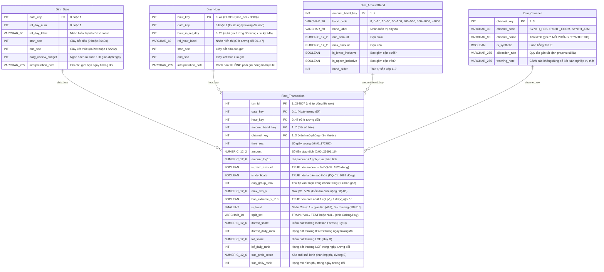

# Thiết kế Kho dữ liệu Star Schema & Sơ đồ ERD — Đề tài 6: Phát hiện giao dịch thẻ gian lận

**Người thực hiện:** Quỳnh (Thành viên C — Data Engineer / SQL & OLAP)  
**Bàn giao cho:** Mong (E — Dashboard Superset), Cường (B — Tiền xử lý), Huy (D — Anomaly Detection), Khang (A — Data Audit)  
**Đối chiếu nguồn:** Khớp 100% với số đo thật từ `outputs/audit_metrics.json`, `outputs/data_dictionary.csv` và `outputs/quality_issues.csv` (v1, ngày 26/10/2026, `sha256: 76274b691b16a6c49d3f159c883398e03ccd6d1ee12d9d8ee38f4b4b98551a89`).

---

## 1. Xác định Grain (Độ mịn) & Nguyên tắc Thiết kế (Bước C1 – C3)

### 1.1. Grain (Độ mịn của bảng Fact)
- **Một dòng trong `Fact_Transaction` đại diện cho đúng MỘT bản ghi giao dịch thẻ tín dụng** trong tập dữ liệu gốc `creditcard.csv` (`284 807` dòng).
- **Định danh giao dịch (`txn_id`):** Do dữ liệu gốc không có cột ID giao dịch hay mã khách hàng/thẻ (`DQ-07`), `txn_id` được sinh theo quy tắc tất định (deterministic, tái lập 100%): là số thứ tự dòng `1 .. 284807` theo đúng thứ tự xuất hiện trong file `data/raw/creditcard.csv`.
- **Xử lý dòng trùng lặp (`DQ-01` — 1 081 bản sao thừa):**
  - Kho dữ liệu nạp đầy đủ `284 807` dòng từ nguồn để bảo đảm đối soát khớp tuyệt đối tổng số giao dịch và `492` nhãn gian lận với báo cáo Audit của Khang (A).
  - Mỗi dòng trong `Fact_Transaction` có cờ `is_duplicate BOOLEAN NOT NULL` (`FALSE` cho bản ghi xuất hiện đầu tiên của mỗi bộ 31 cột, `TRUE` cho `1 081` bản sao thừa — chứa `19` giao dịch gian lận).
  - Nhờ thiết kế này, các truy vấn OLAP và Dashboard Superset có thể lọc hoặc so sánh song song cả 2 chế độ: **Toàn bộ dữ liệu gốc (`284 807` dòng, `492` fraud)** và **Dữ liệu đã khử trùng (`283 726` dòng, `473` fraud)**, đảm bảo tính nhất quán tuyệt đối dù Cường (B) chọn phương án nào trong `decision_log.csv`.

### 1.2. Phân định rõ Dữ liệu quan sát thật vs. Dữ liệu dẫn xuất / Mô phỏng (Tuân thủ Tiêu chí 4 & 10)
| Bảng | Loại bảng | Nguồn gốc dữ liệu | Quy tắc diễn giải bắt buộc |
|---|---|---|---|
| `Fact_Transaction` | Fact | Quan sát thật từ `creditcard.csv` + Điểm mô hình từ Huy (D) / Mong (E) | Nhãn `is_fraud` chỉ dùng để đối soát OLAP và đánh giá mô hình; **không** dùng làm đầu vào cho mô hình không giám sát. |
| `Dim_Date` | Dimension | Dẫn xuất từ cột `Time` (`rel_day = FLOOR(Time / 86400)`) | **Ngày tương đối** (`0` hoặc `1`). Không gắn ngày lịch thực tế vì nguồn chỉ cho biết "2 ngày trong tháng 9/2013", không rõ ngày bắt đầu (`DQ-05`). |
| `Dim_Hour` | Dimension | Dẫn xuất từ cột `Time` (`rel_hour = FLOOR(Time / 3600)`) | **Giờ tương đối** (`0 .. 47` kể từ giao dịch đầu tiên). Tuyệt đối **không** diễn giải thành "ban ngày / ban đêm" vì không biết mốc 0 giây ứng với mấy giờ đồng hồ (`DQ-05`). |
| `Dim_AmountBand` | Dimension | Dẫn xuất theo quy tắc phân dải cột `Amount` | 7 dải số tiền khớp 100% với bảng `outputs/amount_band_fraud_rate.csv` trong EDA của Khang (A). Không gán đơn vị tiền tệ cố định nếu nguồn không xác nhận (`DQ-07`). |
| `Dim_Channel` | Dimension | **Dữ liệu mô phỏng (SYNTHETIC)** theo gợi ý trong đề bài | Cột `is_synthetic = TRUE`. Chỉ dùng để minh họa khả năng slice/dice đa chiều của Star Schema theo đề cương học phần; **tuyệt đối không** rút ra kết luận nghiệp vụ về kênh thanh toán từ chiều này (`DQ-07`). |

---

## 2. Sơ đồ Thực thể – Liên kết (ERD — Star Schema) (Bước C4)

---

## 3. Đặc tả Chi tiết Các Bảng, Kiểu dữ liệu & Ràng buộc Toàn vẹn (Bước C4)

### 3.1. Bảng Staging: `stg_raw_transactions` (`sql/01-staging.sql`)
- Lưu nguyên bản 31 cột từ `data/raw/creditcard.csv` cùng khóa tự tăng `raw_row_id SERIAL PRIMARY KEY` (`1..284807`).
- Các cột `v1` đến `v28` được giữ đầy đủ ở tầng Staging (`DOUBLE PRECISION NOT NULL`) để phục vụ tính toán đặc trưng tổng hợp (`max_abs_v`, `has_extreme_v_z10`) và kiểm tra trùng lặp trên toàn bộ 31 cột.

### 3.2. Các bảng Dimension (`sql/02-star-schema.sql`)

1. **`Dim_Date` (2 dòng: `date_key` $\in \{0, 1\}$):**
   - `date_key = 0`: `0s – 86 399s` (`144 786` giao dịch, `281` fraud, ngân sách rà soát `100` giao dịch/ngày).
   - `date_key = 1`: `86 400s – 172 792s` (`140 021` giao dịch, `211` fraud, ngân sách rà soát `100` giao dịch/ngày).
2. **`Dim_Hour` (48 dòng: `hour_key` $\in \{0 .. 47\}$):**
   - Khớp chính xác 48 dòng trong `outputs/relative_hour_fraud_rate.csv` của Khang (A).
   - `hour_in_rel_day = hour_key % 24` cho phép so sánh giờ tương đối thứ $k$ của Ngày 0 với giờ tương đối thứ $k$ của Ngày 1 bằng phép toán OLAP `CUBE(date_key, hour_in_rel_day)`.
3. **`Dim_AmountBand` (7 dòng: `amount_band_key` $\in \{1 .. 7\}$):**
   - Khớp chính xác với `pd.cut(df["Amount"], [-0.01, 0, 10, 50, 100, 500, 1000, 1e9])` trong `notebooks/01_data_audit.ipynb`:
     - `1`: `'0'` ($\text{Amount} = 0$) — `1 825` dòng, `27` fraud (`1,479%`).
     - `2`: `'0–10'` ($0 < \text{Amount} \le 10$) — `98 439` dòng, `222` fraud (`0,226%`).
     - `3`: `'10–50'` ($10 < \text{Amount} \le 50$) — `90 781` dòng, `57` fraud (`0,063%`).
     - `4`: `'50–100'` ($50 < \text{Amount} \le 100$) — `37 254` dòng, `56` fraud (`0,150%`).
     - `5`: `'100–500'` ($100 < \text{Amount} \le 500$) — `47 366` dòng, `95` fraud (`0,201%`).
     - `6`: `'500–1000'` ($500 < \text{Amount} \le 1000$) — `6 202` dòng, `26` fraud (`0,419%`).
     - `7`: `'>1000'` ($\text{Amount} > 1000$) — `2 940` dòng, `9` fraud (`0,306%`).
4. **`Dim_Channel` (3 dòng mô phỏng: `channel_key` $\in \{1, 2, 3\}$):**
   - Vì `creditcard.csv` không có kênh giao dịch, để script `03-transform.sql` chạy lại 100% cho cùng một kết quả (idempotent & deterministic), `channel_key` được gán theo hàm băm tất định từ `txn_id` (`1 + MOD(ABS(HASHTEXT(txn_id::TEXT)), 3)`), hoàn toàn độc lập với nhãn `Class` và các đặc trưng nên không tạo ra bất kỳ tương quan giả tạo nào. Mọi nhãn hiển thị đều ghi rõ `(Mô phỏng - Synthetic)`.

### 3.3. Quy tắc NULL & Kiểm tra Toàn vẹn (Data Integrity Rules — Bước C9)
Sau khi chạy `01-staging.sql` $\rightarrow$ `02-star-schema.sql` $\rightarrow$ `03-transform.sql`, kho dữ liệu bắt buộc phải vượt qua 8 chốt kiểm tra tự động sau:
1. **Tổng số dòng:** `COUNT(*)` của `stg_raw_transactions` = `COUNT(*)` của `Fact_Transaction` = **284 807**.
2. **Tổng nhãn gian lận:** `SUM(is_fraud)` = **492**; số dòng không gian lận = **284 315**.
3. **Số bản sao thừa (`DQ-01`):** `COUNT(*) FILTER (WHERE is_duplicate = TRUE)` = **1 081** (trong đó `SUM(is_fraud) FILTER (WHERE is_duplicate = TRUE)` = **19**). Số dòng sau khử trùng = **283 726** (trong đó fraud = **473**).
4. **Giao dịch `Amount = 0` (`DQ-02`):** `COUNT(*) FILTER (WHERE is_zero_amount = TRUE)` = **1 825** (trong đó fraud = **27**).
5. **Đối soát theo Ngày tương đối:** Ngày 0 có **144 786** dòng (**281** fraud); Ngày 1 có **140 021** dòng (**211** fraud).
6. **Không có khóa ngoại mồ côi (Orphan FK = 0):** Mọi `date_key`, `hour_key`, `amount_band_key`, `channel_key` trong `Fact_Transaction` đều tồn tại trong bảng Dimension tương ứng.
7. **Quy tắc NULL:** Tất cả các khóa, số tiền, thời gian, cờ chất lượng dữ liệu và nhãn `is_fraud` đều `NOT NULL` (0 giá trị thiếu). Chỉ các cột điểm mô hình (`iforest_score`, `lof_score`, `sup_prob_score`, `split_set`) được phép `NULL` trước khi tích hợp kết quả từ Huy (D) và Mong (E).
8. **Tính Idempotent:** Chạy lại cả 3 script lần thứ 2 liên tiếp không báo lỗi và các con số ở mục 1–7 giữ nguyên tuyệt đối.

